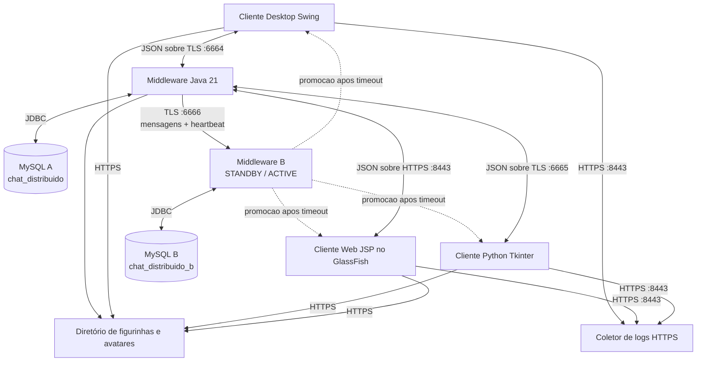

<p align="center">
  
</p>

<p align="center">
  
  
  
  
  
  
</p>

<p align="center">
  <b>Chat distribuído com clientes Desktop, Web e Python, middleware Java, comunicação segura e persistência centralizada em MySQL.</b>
</p>

---

# Chat Distribuído — Documentação do Software

Projeto acadêmico da disciplina **Sistemas Distribuídos**, do curso de Engenharia de Computação. A plataforma utiliza um middleware Java como núcleo da comunicação entre clientes Desktop, Web e Python. As mensagens são trocadas por um protocolo JSON comum e persistidas em um banco MySQL acessado pelo middleware.

> **Estado desta documentação:** atualização de 20/11/2026. A persistência MySQL, a comunicação Desktop/Web/Python e a replicação síncrona A→B foram testadas localmente pelo grupo. O código também inclui promoção automática do reserva, reconexão dos clientes e publicidade multicast com gateway WebSocket para o navegador. Ainda precisam ser demonstrados: queda real do Middleware A com os clientes já abertos, rede multicast entre hosts, execução em máquinas/instâncias independentes e banco remoto em outro host.

## Sumário

- [1. Visão geral](#1-visão-geral)
- [2. Estado dos requisitos do Trabalho 1](#2-estado-dos-requisitos-do-trabalho-1)
- [3. Arquitetura atual](#3-arquitetura-atual)
- [4. Módulos do repositório](#4-módulos-do-repositório)
- [5. Comunicação e protocolo](#5-comunicação-e-protocolo)
- [6. Serviços, portas e endpoints](#6-serviços-portas-e-endpoints)
- [7. Persistência MySQL](#7-persistência-mysql)
- [8. Configuração do banco](#8-configuração-do-banco)
- [9. Recursos visuais e logs](#9-recursos-visuais-e-logs)
- [10. Compilação](#10-compilação)
- [11. Execução e implantação](#11-execução-e-implantação)
- [12. Configuração de rede](#12-configuração-de-rede)
- [13. Testes já realizados e testes pendentes](#13-testes-já-realizados-e-testes-pendentes)
- [14. Banco B, replicação e tolerância a falhas](#14-banco-b-replicação-e-tolerância-a-falhas)
- [15. Failover e publicidade multicast](#15-failover-e-publicidade-multicast)
- [16. Segurança e arquivos que não devem ser versionados](#16-segurança-e-arquivos-que-não-devem-ser-versionados)

## 1. Visão geral

A plataforma possui três modalidades de cliente:

- **Desktop:** aplicação Java Swing. Utiliza TCP protegido por TLS para enviar mensagens e consultar o histórico.
- **Web:** aplicação JSP publicada no GlassFish. O navegador utiliza HTTPS para acessar a API do middleware.
- **Python:** aplicação gráfica Tkinter, desenvolvida em linguagem diferente de Java. Utiliza TCP/TLS e HTTPS para conversar com o middleware e carregar recursos visuais.

O middleware é responsável por validar e processar as mensagens, persistir o conteúdo no MySQL, recuperar o histórico, renderizar as mensagens para os clientes e disponibilizar recursos visuais e coleta de logs.

Os clientes **não acessam o MySQL diretamente**. Somente o middleware possui as credenciais JDBC.

### Tecnologias principais

| Componente | Tecnologia | Empacotamento |
|---|---|---|
| Protocolo compartilhado | Java 17, Jackson e JSON | JAR Maven |
| Middleware | Java 21, Virtual Threads, sockets TLS, HTTPS e JDBC | JAR Maven |
| Cliente Desktop | Java 21, Swing e TLS | JAR Maven |
| Cliente Web | JSP, HTML, CSS e JavaScript; publicado no GlassFish | WAR Maven |
| Cliente Python | Python 3, Tkinter, sockets TLS e HTTPS | Código Python |
| Persistência | MySQL Community Server 8.4 e MySQL Connector/J | Banco de dados remoto ou local |

## 2. Estado dos requisitos do Trabalho 1

A tabela diferencia o que já foi implementado do que ainda precisa de validação ou desenvolvimento. Uma funcionalidade testada localmente não é considerada automaticamente demonstrada em uma infraestrutura com vários hosts.

| Requisito do enunciado | Pontos | Situação atual |
|---|---:|---|
| Banco de dados remoto e modelo de persistência | 4,0 | **MySQL/JDBC e schema A/B implementados; persistência e recuperação local testadas.** Falta demonstrar conexão JDBC de um middleware em outro host para o MySQL remoto. |
| Protocolo JSON | 3,0 | **Implementado** nos fluxos Desktop, Web, Python e replicação interna. |
| Criptografia das comunicações | 3,0 | **TLS/HTTPS implementado** nos canais de clientes e na replicação A→B. A demonstração em hosts distintos ainda depende dos certificados/SAN e da rede. |
| Novo cliente gráfico em outra linguagem | 5,0 | **Cliente Python implementado e testado**, com texto, emojis, figurinhas, histórico e failover configurável. |
| Publicidade sincronizada por multicast | 4,0 | **Implementada no código:** emissor UDP multicast, receptores Desktop/Python e gateway WebSocket para Web. Falta comprovar a recepção simultânea em vários hosts/rede de hotspot. |
| Replicação, segundo banco e failover automático | 6,0 | **Replicação síncrona A→B validada localmente pelos três clientes e persistente após reiniciar os processos.** Promoção automática e reconexão foram implementadas; falta o teste de queda de A com clientes já abertos e a validação com B/DB em host independente. |

Também é obrigatório preparar e demonstrar pelo menos duas instâncias de cada modalidade (duas Web, duas Desktop e duas Python), envolvendo vários hosts na rede. Essa demonstração ainda precisa ser organizada e comprovada.

## 3. Arquitetura atual

O middleware centraliza a comunicação e a persistência. Enquanto A está ativo, ele atende clientes, grava no Banco A e replica cada mensagem por TLS para o B antes de responder ACK. O B inicia em `--replica-only`, recebe heartbeats e mensagens pela porta 6666 e grava no Banco B. Se o heartbeat expirar, o B promove-se para ACTIVE e inicia os serviços de clientes; o A detecta o estado ACTIVE ou a perda de lease e interrompe seus listeners para evitar split-brain. Os clientes mantêm os endereços de A e B e repetem solicitações durante a janela de promoção.



O GlassFish hospeda a interface Web. O servidor HTTPS e os listeners TCP/TLS são executados pelo processo do middleware Java. São serviços distintos, embora façam parte da mesma plataforma.

### 3.1. Topologia de desenvolvimento atual

Durante o desenvolvimento, os componentes podem ser executados na mesma máquina:

- MySQL: `127.0.0.1:3306`.
- Middleware: listeners TCP/TLS e servidor HTTPS locais.
- GlassFish: publicação da aplicação Web.
- Clientes: Desktop, navegador e Python.

Na demonstração final, o MySQL deverá ser acessível pela rede e os clientes/middlewares deverão executar em hosts distintos, conforme o enunciado. O endereço do banco é configurável por variável de ambiente; não deve ser codificado nas classes Java. Para demonstrar tolerância à falha física, o Banco B também deve estar em outra instância/host, e não apenas em outro schema do mesmo MySQL.

## 4. Módulos do repositório

A estrutura principal do repositório é:

```text
Sistemas-Distribuidos-Backup/
├── pom.xml                              # Agregador Maven multi-módulo
├── Chat_Protocolo/
│   └── pom.xml
├── SD-v4/
│   ├── Chat_Cliente_Desktop/
│   │   └── pom.xml
│   └── Chat_Middleware_Service/
│       ├── pom.xml
│       ├── src/main/java/pacote/
│       │   ├── Util.java
│       │   ├── DesktopJsonRecepcaoThread.java
│       │   ├── TerceirosJsonRecepcaoThread.java
│       │   ├── replication/             # Replicação TLS, heartbeat e promoção do reserva
│       │   ├── advertising/             # Emissor UDP multicast
│       │   └── database/
│       │       ├── DatabaseConfig.java
│       │       ├── DatabaseConnection.java
│       │       ├── MensagemDAO.java
│       │       └── TestarConexaoMySQL.java
│       ├── data/                        # Configuração TLS, marcador e logs locais; não versionar
│       ├── figurinhas/                  # Recursos visuais do chat
│       └── publicidade/                 # Banners/GIFs anunciados por multicast
├── SD-v6/
│   └── Chat_Cliente_Web/
│       └── pom.xml
├── Chat_Cliente_Python/
│   ├── main.py
│   ├── diagnostico.py
│   └── chat_client/
│       ├── config.py
│       ├── gui.py
│       ├── protocol.py
│       └── transport.py
└── SD-v4/certificados/
    └── chat-root-ca.cer                # Certificado público da CA
```

### 4.1. Protocolo compartilhado — `Chat_Protocolo`

Define o envelope JSON utilizado pelos clientes e middleware. O projeto possui as classes `ChatMessage` e `JsonProtocol` e é dependência Maven dos módulos Java que utilizam o protocolo.

Coordenadas Maven:

```text
com.mycompany:Chat_Protocolo:1.0.0
```

### 4.2. Middleware — `SD-v4/Chat_Middleware_Service`

É o núcleo da plataforma. Responsabilidades principais:

- inicializar os serviços TCP/TLS e HTTPS;
- validar e processar mensagens JSON;
- renderizar mensagens em HTML para o histórico;
- persistir mensagens por meio de JDBC;
- consultar mensagens no MySQL;
- disponibilizar figurinhas, avatares e emojis;
- receber logs dos clientes e registrar erros internos.

Classes relevantes:

| Classe | Responsabilidade |
|---|---|
| `Run.java` | Inicialização do middleware e do painel/modo sem interface. |
| `Util.java` | Inicialização dos serviços, histórico, persistência, endpoints e logs. |
| `DesktopJsonRecepcaoThread.java` | Listener JSON/TLS para o cliente Desktop. |
| `TerceirosJsonRecepcaoThread.java` | Listener JSON/TLS para clientes de outras linguagens, incluindo Python. |
| `ConfiguracaoTLS.java` | Configuração TLS do servidor. |
| `database.DatabaseConfig` | Leitura e validação das configurações MySQL. |
| `database.DatabaseConnection` | Abertura e teste de conexões JDBC. |
| `database.MensagemDAO` | Inserção e consulta das mensagens persistidas. |

### 4.3. Cliente Desktop — `SD-v4/Chat_Cliente_Desktop`

Aplicação Swing para identificação do usuário, envio de mensagens, consulta do histórico, seleção de emojis e figurinhas. O cliente utiliza o canal JSON/TLS na porta 6664 e HTTPS para buscar recursos disponibilizados pelo middleware.

### 4.4. Cliente Web — `SD-v6/Chat_Cliente_Web`

Aplicação JSP publicada no GlassFish. Arquivos relevantes:

| Arquivo | Responsabilidade |
|---|---|
| `index.jsp` | Entrada e seleção de identificação visual. |
| `chat.jsp` | Validação da entrada, sessão e organização da interface. |
| `mensagem.jsp` | Consulta e apresentação periódica do histórico. |
| `conversa.jsp` | Envio de mensagens e consulta de catálogos. |
| `WEB-INF/web.xml` | Endereços HTTPS do middleware e do coletor. |

A interface é servida pelo GlassFish. As operações do chat e o carregamento dos recursos são realizados por HTTPS diretamente no middleware.

### 4.5. Cliente Python — `Chat_Cliente_Python`

Cliente gráfico desenvolvido em Python/Tkinter. Permite consultar o histórico, enviar mensagens de texto, inserir emojis Unicode e selecionar/enviar figurinhas do catálogo disponibilizado pelo middleware. O transporte utiliza JSON sobre TLS e valida o certificado da CA do projeto.

O arquivo `diagnostico.py` permite testar a configuração, o certificado TLS e a consulta do histórico sem abrir a interface gráfica.

## 5. Comunicação e protocolo

Os fluxos novos utilizam JSON codificado em UTF-8, com uma mensagem por linha e delimitador `\n` nos sockets TCP/TLS. O protocolo compartilhado define campos como:

| Campo | Finalidade |
|---|---|
| `protocolVersion` | Versão do protocolo. |
| `id` | Identificador único da mensagem/operação. |
| `correlationId` | Associação com uma requisição anterior, quando aplicável. |
| `type` | Tipo da operação. |
| `sender` | Remetente. |
| `recipient` | Destinatário. |
| `content` | Conteúdo textual. |
| `mode`, `color`, `avatar`, `sticker` | Informações de apresentação e recursos. |
| `sentAt` | Data/hora informada na mensagem. |
| `metadata` | Metadados adicionais. |

Tipos utilizados incluem `SEND_MESSAGE`, `HISTORY_REQUEST`, `HISTORY_RESPONSE`, `ACK` e `ERROR`. Os clientes e middleware compartilham a versão de protocolo 1.

### 5.1. Fluxo de envio

1. O cliente monta o envelope `SEND_MESSAGE`.
2. O middleware recebe e desserializa o JSON.
3. O middleware valida os campos necessários e gera o HTML da mensagem.
4. O `MensagemDAO` grava os campos estruturados e `rendered_html` no MySQL.
5. O middleware envia `ACK` somente após a operação de persistência concluir com sucesso.

### 5.2. Fluxo de histórico

1. O cliente envia `HISTORY_REQUEST`.
2. O middleware consulta `MensagemDAO.buscarHistoricoHtml()`.
3. Os fragmentos HTML são unidos e enviados em `HISTORY_RESPONSE`.
4. Os clientes apresentam o histórico recebido.

## 6. Serviços, portas e endpoints

### 6.1. Portas atuais

| Porta | Protocolo | Responsabilidade |
|---:|---|---|
| 6664 | TCP sobre TLS | Cliente Desktop Java: envio e histórico JSON. |
| 6665 | TCP sobre TLS | Clientes de outras linguagens, incluindo Python. |
| 8443 | HTTPS | API do chat, recursos visuais, saúde do serviço e coletor de logs. |
| 8080 | HTTP (padrão) | Interface Web hospedada no GlassFish; pode variar conforme o domínio. |
| 3306 | MySQL/TCP | Banco acessado pelo middleware. |

As portas antigas 6661, 6662, 6663, 8081 e 8082 permanecem apenas como referências legadas no código/configuração, sem listeners oficiais na arquitetura atual.

### 6.2. Endpoints HTTPS do middleware

Base local de desenvolvimento: `https://127.0.0.1:8443`.

| Método | Endpoint | Descrição | Resposta |
|---|---|---|---|
| GET | `/health` | Verifica disponibilidade do HTTPS. | Texto `OK`. |
| POST | `/api/messages` | Recebe `HISTORY_REQUEST` ou `SEND_MESSAGE` em JSON. | `HISTORY_RESPONSE`, `ACK` ou `ERROR` em JSON. |
| GET | `/api/stickers` | Lista as figurinhas disponíveis. | Array JSON de nomes de arquivos. |
| GET | `/api/avatars` | Lista os avatares disponíveis. | Nomes separados por quebra de linha. |
| GET | `/api/emojis` | Lista os emojis oferecidos pelo sistema. | Um item por linha. |
| GET | `/figurinhas/{arquivo}` | Recupera uma figurinha. | Arquivo de imagem. |
| GET | `/figurinhas/avatars/{arquivo}` | Recupera um avatar. | Arquivo de imagem. |
| POST | `/api/logs` | Recebe logs de clientes quando o coletor está ativado. | Texto `OK` ou erro HTTP. |

O endpoint `/api/stickers` retorna JSON. Os clientes que consomem esse endpoint devem interpretar a resposta como JSON, e não como uma lista de linhas de texto.

### 6.3. GlassFish

O endereço local de desenvolvimento é normalmente:

```text
http://localhost:8080/Chat_Cliente_Web/
```

O GlassFish hospeda a interface Web, mas não substitui o middleware. O middleware HTTPS deve estar em execução para que o navegador consiga enviar mensagens e consultar o histórico.

## 7. Persistência MySQL

O histórico oficial da plataforma está centralizado no MySQL. O middleware utiliza MySQL Connector/J por JDBC; os clientes não possuem conexão nem credenciais de banco.

### 7.1. Banco e tabela

Banco utilizado:

```text
chat_distribuido
```

Tabela principal:

```text
mensagens
```

O schema versionado deve ser mantido em `database/schema.sql`. A estrutura utilizada é:

| Coluna | Tipo | Descrição |
|---|---|---|
| `message_id` | `CHAR(36)` | Identificador único da mensagem; chave primária. |
| `message_type` | `VARCHAR(32)` | Tipo da mensagem. |
| `sender` | `VARCHAR(120)` | Remetente. |
| `recipient` | `VARCHAR(120)` | Destinatário. |
| `content` | `MEDIUMTEXT` | Conteúdo textual. |
| `mode` | `VARCHAR(32)` | Modo de apresentação. |
| `color` | `VARCHAR(16)` | Cor da mensagem. |
| `avatar` | `VARCHAR(255)` | Identificador do avatar. |
| `sticker` | `VARCHAR(255)` | Identificador da figurinha. |
| `sent_at` | `DATETIME(6)` | Data/hora de envio em UTC. |
| `metadata` | `JSON` | Metadados estruturados. |
| `rendered_html` | `MEDIUMTEXT` | HTML usado pelos clientes no histórico. |
| `created_at` | `DATETIME(6)` | Data/hora de inserção no banco. |

A tabela utiliza InnoDB, `utf8mb4`, chave primária em `message_id` e índices para data de envio e destinatário/data.

### 7.2. Camada JDBC

| Classe | Responsabilidade |
|---|---|
| `DatabaseConfig` | Carrega host, porta, banco, usuário, senha e modo SSL por variáveis de ambiente. |
| `DatabaseConnection` | Abre conexões via `DriverManager` e realiza teste básico. |
| `MensagemDAO` | Executa `INSERT`, inserção idempotente por `message_id`, consulta o HTML em ordem cronológica e conta os registros. |
| `replication.ReplicacaoClient` | Envia mensagens do principal ao reserva por TLS e aguarda ACK. |
| `replication.ReplicacaoRecepcaoThread` | Recebe replicações no Middleware B e persiste no Banco B sem recursão. |
| `replication.ReplicacaoConfig` | Valida host, porta, token e CA usados no canal de replicação. |

O middleware valida a conexão com o banco durante a inicialização. A consulta do histórico e a gravação de novas mensagens utilizam a tabela `mensagens`. Quando `CHAT_REPLICATION_ENABLED=true` no Middleware A, a gravação utiliza inserção idempotente e aguarda a confirmação TLS do Middleware B antes de confirmar a mensagem ao cliente.

### 7.3. Persistência confirmada

Foi testado localmente que:

- o middleware conecta ao MySQL 8.4.13;
- a tabela `mensagens` é acessível pela camada JDBC;
- mensagens podem ser persistidas e consultadas pelo histórico compartilhado;
- o histórico permanece disponível depois de encerrar e iniciar novamente o processo do middleware.

O TXT antigo não é mais a fonte oficial do histórico no fluxo atualizado. O conteúdo legado pode ser preservado para consulta ou migração manual, mas não deve voltar a ser utilizado como mecanismo principal de persistência.

### 7.4. Criar o banco a partir do repositório

Execute o script `database/schema.sql` no MySQL Workbench ou por um cliente MySQL com permissões para criar banco e tabela. O middleware não cria automaticamente o schema; o banco e a tabela devem existir antes de iniciar o serviço.

Depois, crie um usuário próprio para a aplicação e conceda somente as permissões necessárias à tabela `mensagens` (leitura e inserção para a implementação atual). Não utilize `root` na aplicação.

## 8. Configuração do banco

O middleware lê a configuração exclusivamente de variáveis de ambiente. Nenhuma senha deve ser gravada no código ou em arquivos versionados.

| Variável | Obrigatória? | Padrão/Exemplo local |
|---|---|---|
| `CHAT_DB_HOST` | Não | `127.0.0.1` |
| `CHAT_DB_PORT` | Não | `3306` |
| `CHAT_DB_NAME` | Não | `chat_distribuido` |
| `CHAT_DB_USER` | Sim | Usuário dedicado, por exemplo `chat_app` |
| `CHAT_DB_PASSWORD` | Sim | Senha privada do usuário do banco. |
| `CHAT_DB_SSL_MODE` | Não | `PREFERRED` |
| `CHAT_REPLICATION_ENABLED` | Não | `false`; no principal com B ativo, definir `true`. |
| `CHAT_REPLICATION_HOST` | Quando habilitada | Host/IP do Middleware B; local: `127.0.0.1`. |
| `CHAT_REPLICATION_PORT` | Não | `6666`. |
| `CHAT_REPLICATION_TOKEN` | Quando habilitada/no receptor | Segredo compartilhado entre A e B; nao versionar. |
| `CHAT_REPLICATION_CA_FILE` | Não | Caminho da CA pública; padrão `SD-v4/certificados/chat-root-ca.cer`. |

Modos SSL aceitos pelo código: `PREFERRED`, `REQUIRED`, `VERIFY_CA` e `VERIFY_IDENTITY`. O modo efetivamente escolhido deve ser compatível com a configuração TLS do servidor MySQL. O desenvolvimento local foi validado com `PREFERRED`; a segurança TLS do enlace JDBC em outra máquina ainda deve ser configurada e testada antes da demonstração remota.

### 8.1. Configuração temporária no PowerShell

Os comandos abaixo definem variáveis apenas para a janela atual do PowerShell e para os processos iniciados por ela. Substitua o usuário e a senha pelos valores criados localmente; não inclua a senha em commits ou prints públicos.

```powershell
$env:CHAT_DB_HOST = "127.0.0.1"
$env:CHAT_DB_PORT = "3306"
$env:CHAT_DB_NAME = "chat_distribuido"
$env:CHAT_DB_USER = "chat_app"
$env:CHAT_DB_PASSWORD = "<SENHA_LOCAL>"
$env:CHAT_DB_SSL_MODE = "PREFERRED"
```

Para tornar as variáveis persistentes no Windows, configure-as nas variáveis de ambiente do usuário ou do sistema. Depois de alterá-las, feche e reabra o NetBeans/terminal para que o novo processo as receba.

### 8.2. Máquina que hospeda o banco

Na configuração de desenvolvimento atual, MySQL e middleware estão na mesma máquina e `CHAT_DB_HOST` pode permanecer como `127.0.0.1`.

Para a demonstração em rede, a máquina que hospeda o MySQL será o servidor do histórico central. O middleware deverá usar o endereço IPv4 dessa máquina. Será necessário:

1. criar uma conta MySQL autorizada somente para o host/IP do middleware;
2. configurar o MySQL para aceitar conexões na interface de rede apropriada;
3. permitir TCP 3306 no Firewall do Windows somente a partir do middleware;
4. configurar `CHAT_DB_HOST` no ambiente do middleware;
5. testar a conexão JDBC a partir do outro computador.

Não exponha a porta 3306 à internet. O teste de acesso MySQL remoto entre computadores ainda está pendente.

### 8.3. Configuração do canal de replicação

O Middleware A envia replicações ao Middleware B por um canal TCP/TLS interno, padrão na porta `6666`. Configure no processo A:

- `CHAT_REPLICATION_ENABLED=true`;
- `CHAT_REPLICATION_HOST` com o endereço do Middleware B;
- `CHAT_REPLICATION_PORT=6666`;
- `CHAT_REPLICATION_TOKEN` com o mesmo segredo definido no B;
- opcionalmente `CHAT_REPLICATION_CA_FILE` com o caminho da CA pública.

No processo B, configure `CHAT_DB_NAME=chat_distribuido_b`, `CHAT_DB_USER=chat_app_b`, a senha correspondente, `CHAT_REPLICATION_PORT=6666` e o mesmo `CHAT_REPLICATION_TOKEN`. O B é iniciado com `--replica-only` e não inicia os listeners de clientes nesta primeira fase.

O segredo e as credenciais são lidos do ambiente do processo. Não os grave em scripts, arquivos versionados ou linhas de comando.

## 9. Recursos visuais e logs

### 9.1. Figurinhas e avatares

As imagens ficam no diretório `figurinhas/` relativo à pasta-base do middleware. Os avatares ficam em `figurinhas/avatars/`. O middleware lista os arquivos aceitos e disponibiliza seu conteúdo por HTTPS. As extensões de imagem reconhecidas incluem PNG, GIF, JPG, JPEG e WEBP.

A pasta pode ser preenchida com os arquivos visuais do projeto. Os arquivos de imagem precisam ser distribuídos com a implantação dos dois middlewares, usando os mesmos nomes e conteúdos em A e B; não são gravados na tabela `mensagens`. O catálogo de publicidade é anunciado periodicamente por UDP multicast (padrão `239.255.42.99:5005`) e o arquivo é recuperado por HTTPS em `/publicidade/{arquivo}`. Desktop e Python recebem o datagrama diretamente. O navegador recebe o aviso por WebSocket do gateway executado no GlassFish, pois navegadores não recebem UDP multicast diretamente.

### 9.2. Logs

Os logs de execução permanecem em arquivos locais no diretório `data/logs/`. Eles não são o histórico das conversas.

Arquivos comuns:

| Arquivo | Origem |
|---|---|
| `client_desktop_errors.log` | Cliente Desktop. |
| `client_web_errors.log` | Cliente Web. |
| `client_<tipo>_errors.log` | Outros clientes, como Python, conforme o tipo informado. |
| `server_middleware_desktop_errors.log` | Serviço TCP/TLS Desktop. |
| `server_middleware_web_errors.log` | Serviço HTTPS/Web. |
| `server_middleware_internal_errors.log` | Falhas internas do middleware e integração MySQL. |

O endpoint `/api/logs` utiliza o mesmo servidor HTTPS da porta 8443 e recebe logs quando o coletor é ativado pelo painel. Os diretórios `data/` e `logs/` são dados de execução e não devem ser tratados como código-fonte.

## 10. Compilação

O repositório possui um POM agregador na raiz, que declara os módulos Maven:

- `Chat_Protocolo`;
- `SD-v4/Chat_Cliente_Desktop`;
- `SD-v4/Chat_Middleware_Service`;
- `SD-v6/Chat_Cliente_Web`.

A dependência `Chat_Protocolo` é compilada no mesmo reactor Maven quando se utiliza `-am`.

### 10.1. Compilar somente o middleware e suas dependências

A partir da raiz do repositório:

```powershell
mvn -pl SD-v4/Chat_Middleware_Service -am clean install
```

### 10.2. Compilar todos os módulos

A partir da raiz:

```powershell
mvn clean install
```

Se `mvn` não estiver no `PATH`, o Maven incluído no NetBeans pode ser utilizado. O caminho da instalação é específico de cada computador; não deve ser fixado nos scripts do projeto.

> **Maven Wrapper:** ainda não foi adicionado ao repositório. A inclusão de `mvnw.cmd` e `mvnw` é uma melhoria pendente para padronizar a versão do Maven e simplificar a compilação após um `git clone`.

### 10.3. Artefatos esperados

```text
Chat_Protocolo/target/Chat_Protocolo-1.0.0.jar
SD-v4/Chat_Cliente_Desktop/target/Chat_Cliente_Desktop-1.0-SNAPSHOT.jar
SD-v4/Chat_Middleware_Service/target/Chat_Middleware_Service-1.0-SNAPSHOT.jar
SD-v6/Chat_Cliente_Web/target/Chat_Cliente_Web.war
```

O build Maven dos módulos foi executado com sucesso no ambiente de desenvolvimento. A execução dos artefatos com a IDE fechada e suas dependências externas empacotadas ainda deve ser validada antes da videoaula.

## 11. Execução e implantação

### 11.1. Middleware

O ponto de entrada configurado no manifesto do JAR é `pacote.Run`. O middleware disponibiliza o painel de controle e os serviços em modo sem interface, conforme os argumentos implementados na classe `Run`.

A execução autônoma do JAR com todas as dependências (protocolo compartilhado e Connector/J) ainda precisa ser empacotada/verificada. Não considere o JAR simples como distribuição autocontida até concluir essa etapa.

Para testar localmente as duas instâncias a partir de dois terminais PowerShell, use os scripts `scripts/windows/iniciar-middleware-b.ps1` (primeiro) e `scripts/windows/iniciar-middleware-a.ps1` (depois). Eles solicitam as senhas sem salvá-las no repositório e usam o Maven local/NetBeans. Os scripts são destinados ao desenvolvimento na mesma máquina; para hosts independentes, altere host, certificado SAN e regras de firewall conforme a rede.

### 11.2. Cliente Desktop

O cliente Desktop é uma aplicação Swing. Seu endereço do middleware deve ser configurado para o host correto. Em execução distribuída, `127.0.0.1` não aponta para o servidor remoto: aponta sempre para o próprio computador do cliente.

### 11.3. Cliente Python

Na pasta `Chat_Cliente_Python`, execute:

```powershell
python main.py
```

Para diagnosticar a conexão TLS e consultar o histórico:

```powershell
python diagnostico.py
```

O cliente utiliza `config.json` para host e porta do middleware e o certificado público da CA para validar o servidor. O endereço de desenvolvimento atual é `127.0.0.1:6665`. Na rede da demonstração, configure o endereço IP/hostname do middleware e mantenha o certificado compatível com o nome utilizado.

### 11.4. Publicação do cliente Web

O cliente Web é empacotado como WAR e publicado no GlassFish. O middleware HTTPS precisa estar ativo antes de testar o chat Web.

Exemplo de implantação com `asadmin` (ajuste `GLASSFISH_HOME` para a instalação local):

```powershell
$env:GLASSFISH_HOME = "C:\caminho\para\GlassFish"
$asadmin = Join-Path $env:GLASSFISH_HOME "bin\asadmin.bat"

& $asadmin list-domains
& $asadmin start-domain domain1
& $asadmin deploy --force=true --precompilejsp=true `
    ".\SD-v6\Chat_Cliente_Web\target\Chat_Cliente_Web.war"
```

Confira a publicação:

```powershell
& $asadmin list-applications --type web
```

O endereço padrão pode ser `http://localhost:8080/Chat_Cliente_Web/`, dependendo da configuração do domínio GlassFish.

## 12. Configuração de rede

### 12.1. Endereços do cliente Web

O arquivo `SD-v6/Chat_Cliente_Web/src/main/webapp/WEB-INF/web.xml` contém parâmetros de configuração do middleware e do coletor de logs. Os valores de desenvolvimento utilizam `https://127.0.0.1:8443`.

Na demonstração distribuída, os parâmetros usados pelo navegador devem apontar para um endereço alcançável a partir do computador que abriu o navegador. O servidor HTTPS deve apresentar um certificado cujo SAN corresponda ao hostname/IP utilizado. O certificado raiz público da CA precisa estar confiável no navegador/Windows.

### 12.2. Endereço do cliente Python

O cliente Python utiliza o host `127.0.0.1` e a porta `6665` na configuração local atual. Para failover, configure `CHAT_SERVER_HOST` e `CHAT_SERVER_BACKUP_HOSTS` (lista separada por vírgulas) ou use `scripts/windows/configurar-clientes-failover.ps1`. A interface multicast local é definida por `CHAT_AD_MULTICAST_INTERFACE` (IPv4 da interface ligada ao hotspot). O certificado da CA deve continuar sendo validado; não desative a verificação TLS.

### 12.3. Banco de dados

O endereço do MySQL é separado do endereço do middleware e é configurado pelas variáveis `CHAT_DB_*`. Os clientes não precisam conhecer o endereço do MySQL.

## 13. Testes já realizados e testes pendentes

### 13.1. Testes já realizados

- conexão JDBC com MySQL 8.4.13 e banco `chat_distribuido`;
- acesso à tabela `mensagens` pela camada DAO;
- inicialização do middleware com consulta do total de mensagens persistidas;
- comunicação JSON/TLS do cliente Desktop;
- comunicação JSON/TLS do cliente Python;
- comunicação HTTPS do cliente Web e consumo JSON do catálogo de figurinhas;
- consulta do histórico armazenado no MySQL;
- preservação do histórico após encerrar e reiniciar o middleware;
- conexão JDBC independente com os schemas `chat_distribuido` e `chat_distribuido_b`;
- envio pelos três clientes com replicação síncrona A→B e conferência dos mesmos `message_id`;
- reinicialização dos dois processos mantendo os registros persistidos;
- inicialização headless do serviço Python na porta 6665;
- recebimento de ao menos uma mensagem replicada pelo receptor TLS do B.

### 13.2. Testes ainda necessários

| Teste | Procedimento | Evidência esperada |
|---|---|---|
| MySQL remoto | Middleware em outro computador, MySQL na máquina que hospeda o banco. | JDBC conecta ao IP remoto e consulta `mensagens`. |
| Persistência de todas as modalidades | Enviar uma mensagem Desktop, Web e Python. | Cada registro aparece na mesma tabela MySQL. |
| Reinicialização | Encerrar e reabrir o middleware. | Histórico continua disponível. |
| Concorrência | Vários clientes enviam mensagens em paralelo. | Registros sem perda ou duplicação indevida. |
| Execução sem IDE | Iniciar middleware e clientes empacotados com NetBeans fechado. | Aplicação continua funcional. |
| Múltiplas instâncias | Executar 2 Web, 2 Desktop e 2 Python. | Seis instâncias interagem. |
| Rede distribuída | Usar vários computadores conectados ao mesmo hotspot/rede. | IPs, hosts e conexões reais demonstráveis. |
| Publicidade multicast | Colocar PNG/GIF em A e B e acompanhar os banners nos três clientes. | Publisher UDP, receptores Desktop/Python e gateway WebSocket Web implementados; falta validar recepção simultânea em hosts e rede/hotspot. |
| Replicação síncrona A→B | Iniciar B em `--replica-only`, habilitar replicação em A e enviar mensagens pelos três clientes. | **Testado pelo grupo:** mesmo `message_id` nos dois bancos e ACK de A após confirmação do B. |
| Idempotência | Reenviar ao B uma replicação já recebida com o mesmo `message_id`. | Código verifica duplicata idêntica e rejeita ID conflitante; comprovação específica por reenvio ainda pode ser registrada. |
| Failover | Deixar clientes abertos, interromper A e continuar usando B sem reiniciar clientes. | Promoção automática e retries A/B implementados; teste explícito de queda de A e continuidade ainda pendente. |
| Independência física | Colocar A/DB A e B/DB B em hosts/instâncias separados. | Pendente para a videoaula; os testes atuais usam dois schemas na mesma instância MySQL local. |

## 14. Banco B, replicação e tolerância a falhas

O Banco B utiliza a mesma tabela `mensagens` do Banco A, no schema `chat_distribuido_b`. Os scripts de criação estão em `database/schema.sql` e `database/schema_b.sql`.

### Replicação síncrona A → B

A replicação foi testada pelo grupo com mensagens enviadas pelos clientes Desktop, Web e Python. O fluxo atual é:

1. A valida e renderiza a mensagem recebida.
2. A persiste o registro no Banco A usando o `message_id` original.
3. A envia um envelope JSON/TLS ao receptor interno do B na porta 6666, contendo a mensagem e o HTML renderizado.
4. B valida o token compartilhado, o tipo e os campos da mensagem e persiste no Banco B.
5. B responde ACK interno; A só então confirma a mensagem ao cliente.

O DAO de B usa `message_id` para idempotência: uma repetição com dados idênticos é reconhecida como duplicata, enquanto um ID reutilizado com conteúdo divergente é rejeitado. Os testes realizados também confirmaram que os registros continuam nos dois bancos após reiniciar os processos.

Se B não responder, A não confirma a mensagem ao cliente. O registro já gravado em A pode permanecer sem confirmação; ainda não existe uma fila persistente geral de reenvio para recuperar mensagens não replicadas.

### Promoção automática e reconexão

B inicia com `--replica-only`, mantendo o receptor TLS e monitorando os heartbeats do principal. Depois de expirar o tempo de promoção sem heartbeat, B inicia os listeners Desktop, Python e HTTPS, passa a responder `ACTIVE` e grava o marcador `data/middleware-reserva-ativo.flag`. A consulta o estado de B periodicamente e, ao receber `ACTIVE` ou perder o lease, interrompe seus listeners. Os clientes possuem endpoints A/B e repetem solicitações durante a janela de promoção, conservando o ID da mensagem para que uma tentativa após resposta perdida seja idempotente.

A promoção e os retries estão implementados no código. **Ainda falta registrar o teste operacional em que A é efetivamente encerrado enquanto as três modalidades de cliente permanecem abertas e continuam a conversar por B.** A independência física também deve ser comprovada com middlewares e bancos em hosts/instâncias separados. Dois schemas na mesma instância MySQL validam a replicação lógica, mas não protegem contra falha física do host/serviço MySQL.

### Recuperação e retorno manual ao A

Depois de B assumir o atendimento, as novas mensagens passam a ser gravadas em B; A pode ficar desatualizado. Não remova o marcador de promoção nem reinicie A como principal antes de sincronizar A com B.

- Para desenvolvimento com os dois schemas na mesma instância MySQL, execute primeiro `database/verificar-sincronizacao.sql`. Se não houver IDs conflitantes, execute `database/sincronizar-banco-a-com-b.sql` e rode novamente a verificação.
- Se os bancos estiverem em hosts diferentes, a recuperação deve usar exportação/importação via staging no host A; os scripts SQL locais não fazem conexão entre servidores.
- Encerre A e B, confirme que A recebeu todos os registros de B e só então execute `scripts/windows/resetar-reserva.ps1`. O script exige a confirmação literal `BANCO_A_SINCRONIZADO` e depois `RESETAR`.
- Inicie B primeiro em standby e A depois. A só deve assumir quando o B confirmar `STANDBY`.

## 15. Failover e publicidade multicast

O procedimento completo está em [GUIA_FAILOVER_PUBLICIDADE.md](GUIA_FAILOVER_PUBLICIDADE.md). Os scripts de inicialização e configuração estão em `scripts/windows/`.

### Publicidade sincronizada

O middleware que está em estado ACTIVE percorre `SD-v4/Chat_Middleware_Service/publicidade/` e anuncia o nome do próximo arquivo por UDP multicast. Valores padrão:

- grupo: `239.255.42.99`;
- porta UDP: `5005`;
- intervalo: `10` segundos (configurável por `CHAT_AD_INTERVAL_SECONDS`).

O datagrama contém uma mensagem JSON `ADVERTISEMENT_UPDATE` com o nome do arquivo. Desktop Java e Python ingressam no grupo multicast e baixam a imagem/GIF pelo HTTPS do middleware ativo. O cliente Python utiliza Pillow para exibir quadros de GIF animado. O navegador não recebe multicast diretamente: `AdvertisementMulticastBridge` no GlassFish recebe UDP e retransmite o JSON ao navegador por WebSocket (`/ws/publicidade`); o navegador obtém a imagem pela API HTTPS com failover A/B.

Copie os mesmos arquivos de imagem, com nomes e conteúdos idênticos, para a pasta `publicidade/` dos dois middlewares. A pasta contém `chat-banner-exemplo.png`. Extensões aceitas: PNG, GIF, JPG, JPEG e WEBP.

A publicidade não deve impedir que o chat suba: se uma interface não suportar multicast, o middleware registra um aviso e mantém os serviços de conversa ativos. Para cumprir o item de avaliação, porém, a demonstração deve comprovar os avisos sincronizados nos três clientes. Alguns hotspots isolam clientes ou bloqueiam multicast; nesse caso, use uma rede que encaminhe multicast. O TTL do emissor é 1, adequado ao segmento local.

Para a videoaula completa, coloque GlassFish em um host que continue ativo quando o Middleware A for desligado; caso GlassFish esteja no próprio host de A, a página Web deixará de existir mesmo que o B assuma o backend.

### Configuração de rede e TLS para a videoaula

- Execute `scripts/windows/configurar-clientes-failover.ps1` em cada computador de cliente/GlassFish, indicando os IPs/DNS de A e B e, se necessário, o IPv4 local de `CHAT_AD_MULTICAST_INTERFACE`.
- No host do Middleware A, passe `-ReplicationHost` com o endereço do B no script `iniciar-middleware-a.ps1`.
- Inicie GlassFish depois de definir as variáveis de ambiente para que os JSPs recebam os endereços A/B e o gateway WebSocket herde a configuração multicast.
- Os certificados de cada middleware precisam conter no SAN o IP/DNS usado para acessá-lo; clientes Java, Python e navegador devem confiar na mesma CA pública.
- A porta 6666 deve ser permitida somente entre os middlewares; as portas 6664, 6665 e 8443 devem ser alcançáveis pelos clientes. A porta UDP 5005 precisa ser permitida no segmento local. O script opcional `scripts/windows/permitir-publicidade-multicast.ps1` cria uma regra de entrada limitada à sub-rede local e exige PowerShell como administrador.
- Banco A e Banco B devem ficar em instâncias/hosts separados para a demonstração de tolerância a falha física.

## 16. Segurança e arquivos que não devem ser versionados

O projeto utiliza TLS/HTTPS para os canais atuais de comunicação cliente–middleware. Os clientes Desktop e Python validam a CA pública do projeto; o navegador deve confiar na mesma CA para acessar o HTTPS sem aviso de certificado.

Cuidados para o repositório:

- versionar o certificado público da CA (`.cer`) quando necessário para validar o servidor;
- **não** versionar keystores ou chaves privadas (`.p12`, `.pfx`, `.jks`, `.keystore`);
- **não** versionar `tls.properties`, arquivos com senhas ou arquivos locais de configuração do banco;
- **não** versionar os diretórios de execução `data/`, logs ou `target/`;
- manter scripts SQL, fontes, POMs e arquivos de exemplo sem credenciais;
- manter `CHAT_REPLICATION_TOKEN` fora do Git e restringir a porta interna 6666 ao middleware principal;
- restringir a porta 3306 à rede e aos hosts necessários; não expor MySQL diretamente à internet.

O `.gitignore` da raiz deve cobrir os padrões acima. Arquivos que já estejam rastreados pelo Git precisam ser removidos do índice separadamente; adicionar uma regra ao `.gitignore` não remove arquivos anteriormente versionados.

---

**Projeto acadêmico — Engenharia de Computação — Sistemas Distribuídos — 2026.**
