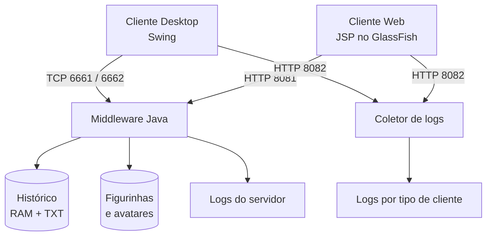

<p align="center">
  
</p>

<p align="center">
  
  
  
  
</p>

<p align="center">
  <b>Chat com clientes Desktop e Web, middleware Java, histórico compartilhado e serviços independentes.</b>
</p>

---

## ✨ Visão geral

Projeto acadêmico de **Sistemas Distribuídos**. O Middleware centraliza a comunicação, o histórico em RAM/TXT, a biblioteca de imagens e os logs. O Desktop utiliza TCP; o cliente Web é publicado no GlassFish e conversa com o Middleware por HTTP.

## 🧩 Módulos

| Módulo | Função | Empacotamento |
|---|---|---|
| `SD-v4/Chat_Middleware_Service` | Serviços TCP/HTTP, persistência, imagens e logs | JAR · Java 21 |
| `SD-v4/Chat_Cliente_Desktop` | Interface Swing para o chat | JAR · Java 21 |
| `SD-v6/Chat_Cliente_Web` | Interface JSP acessada pelo navegador | WAR · Java 17 |

## 🏗️ Arquitetura



### Portas

| Porta | Protocolo | Serviço |
|---:|---|---|
| `6661` | TCP | Consulta do histórico pelo Desktop |
| `6662` | TCP | Recebimento de mensagens do Desktop |
| `8081` | HTTP | API do chat e biblioteca de imagens |
| `8082` | HTTP | Coletor de erros dos clientes |
| `8080` | HTTP | GlassFish (padrão; pode variar) |

### API do Middleware (`:8081`)

| Método | Rota | Uso |
|---|---|---|
| `GET` | `/health` | Verificar disponibilidade |
| `GET` / `POST` | `/api/messages` | Consultar / enviar mensagens |
| `GET` | `/api/stickers` | Listar figurinhas |
| `GET` | `/api/avatars` | Listar avatares |
| `GET` | `/api/emojis` | Obter emojis Unicode |
| `GET` | `/figurinhas/{arquivo}` | Buscar figurinha |
| `GET` | `/figurinhas/avatars/{arquivo}` | Buscar avatar |

O coletor recebe eventos em `POST /api/logs` na porta `8082`.

## 💾 Dados e recursos

Tudo é armazenado na máquina que executa o Middleware:

```text
Chat_Middleware_Service/
├── data/
│   ├── RepositorioDesktop.txt
│   └── logs/
│       ├── client_desktop_errors.log
│       ├── client_web_errors.log
│       ├── server_middleware_desktop_errors.log
│       ├── server_middleware_web_errors.log
│       └── server_middleware_internal_errors.log
└── figurinhas/
    ├── *.png / *.gif / *.jpg / *.webp
    └── avatars/
        └── *.png / *.gif / *.jpg / *.webp
```

Adicione imagens nas pastas correspondentes; os clientes consultam os catálogos pela API. **Respeite exatamente o nome e a extensão dos arquivos**: Linux diferencia maiúsculas de minúsculas. Os emojis são Unicode e não precisam de arquivos de imagem.

Por padrão, os diretórios são resolvidos a partir da pasta do módulo/JAR. Para escolher outra pasta-base:

```powershell
$env:CHAT_SERVER_BASE_DIR = "D:\ChatServidor"
# ou, na inicialização:
java -Dchat.server.baseDir="D:\ChatServidor" -jar .\target\Chat_Middleware_Service-1.0-SNAPSHOT.jar
```

A pasta configurada deve conter (ou permitir criar) `data/`, `figurinhas/` e `figurinhas/avatars/`. Faça backup de `data/RepositorioDesktop.txt` e dos logs antes de trocar de máquina; o Git não transporta os dados gerados durante a execução. Execute uma única instância do Middleware por diretório de dados.

## ⚙️ Decisões técnicas

- **Histórico RAM + TXT:** o histórico é carregado na inicialização. Consultas leem a lista em memória; novas mensagens são gravadas no TXT antes de entrar na lista e receberem confirmação.
- **Concorrência:** `ReentrantReadWriteLock` permite leituras simultâneas e protege gravações/atualizações do histórico. Os logs usam sincronização por arquivo para evitar mistura de registros entre threads.
- **Virtual Threads (Java 21):** escolhidas nos atendimentos TCP/HTTP por serem tarefas predominantemente bloqueantes (espera de conexão, leitura e escrita de rede/arquivo). Isso permite atender conexões concorrentes sem manter uma Platform Thread dedicada para cada conexão. Swing mantém sua EDT para a interface; operações de rede devem ocorrer fora dela.
- **Serviços independentes:** Desktop, API Web e coletor podem ser iniciados e encerrados separadamente pelo painel ou pelo `Util.java`.
- **Imagens centralizadas:** Desktop e Web recebem URLs HTTP do Middleware; nenhum cliente deve gravar caminhos locais nas mensagens.

## 🚀 Compilar

**Requisitos:** JDK 21 para Middleware/Desktop, Maven 3.x e GlassFish compatível com a API Jakarta configurada no projeto. O Web usa alvo de compilação Java 17.

No PowerShell, se `mvn` não estiver no `PATH`, use o Maven incluído no NetBeans (ajuste o caminho à sua instalação):

```powershell
$mvn = "$env:USERPROFILE\Downloads\netbeans-31-bin\netbeans\java\maven\bin\mvn.cmd"
Test-Path $mvn   # deve retornar True
```

Gere os artefatos:

```powershell
# Middleware
Set-Location "SD-v4\Chat_Middleware_Service"
& $mvn clean package

# Desktop
Set-Location "..\Chat_Cliente_Desktop"
& $mvn clean package

# Web
Set-Location "..\..\SD-v6\Chat_Cliente_Web"
& $mvn clean package
```

Saídas esperadas:

```text
Chat_Middleware_Service/target/Chat_Middleware_Service-1.0-SNAPSHOT.jar
Chat_Cliente_Desktop/target/Chat_Cliente_Desktop-1.0-SNAPSHOT.jar
Chat_Cliente_Web/target/Chat_Cliente_Web.war
```

## ▶️ Executar sem NetBeans

### 1. Middleware

Na pasta `SD-v4/Chat_Middleware_Service`:

```powershell
# Com painel de controle
java -jar .\target\Chat_Middleware_Service-1.0-SNAPSHOT.jar

# Sem interface: inicia os serviços configurados
java -jar .\target\Chat_Middleware_Service-1.0-SNAPSHOT.jar --headless
```

### 2. Desktop

Na pasta `SD-v4/Chat_Cliente_Desktop`:

```powershell
java -jar .\target\Chat_Cliente_Desktop-1.0-SNAPSHOT.jar
```

Para conectar a um Middleware em outro computador:

```powershell
java -Dchat.server.host=192.168.1.50 -jar .\target\Chat_Cliente_Desktop-1.0-SNAPSHOT.jar
```

Troque o IP pelo endereço real do servidor.

### 3. Publicar o WAR no GlassFish

Localize `asadmin.bat` (o caminho depende da instalação):

```powershell
Get-ChildItem "$env:USERPROFILE" -Filter asadmin.bat -File -Recurse -ErrorAction SilentlyContinue |
  Select-Object -First 5 -ExpandProperty FullName
```

Defina o caminho encontrado e confira:

```powershell
$asadmin = "C:\caminho\glassfish\bin\asadmin.bat"
Test-Path $asadmin   # deve retornar True
& $asadmin list-domains
& $asadmin start-domain domain1
```

Depois de executar `mvn clean package` no Web:

```powershell
& $asadmin deploy --force=true --precompilejsp=true `
  "C:\caminho\do\repositorio\SD-v6\Chat_Cliente_Web\target\Chat_Cliente_Web.war"

& $asadmin list-applications --type web
```

Acesse `http://localhost:8080/Chat_Cliente_Web/` (ajuste host/porta conforme o domínio). Para atualizar, repita o deploy com `--force=true`; para remover:

```powershell
& $asadmin undeploy Chat_Cliente_Web
```

## 🌐 Rede

No `SD-v6/Chat_Cliente_Web/src/main/webapp/WEB-INF/web.xml`, configure:

- `middleware.baseUrl` e `log.collector.url`: endereços usados pelo servidor Web.
- `middleware.publicBaseUrl` e `log.collector.publicUrl`: endereços acessíveis pelo navegador.

Se o navegador estiver em outro computador, use o IP/hostname do Middleware nos parâmetros públicos (por exemplo, `http://192.168.1.50:8081`). Libere no firewall as portas `6661`, `6662`, `8081`, `8082` e a porta HTTP do GlassFish. Não exponha a porta administrativa do GlassFish aos clientes.

> **Segurança:** configuração voltada a demonstração acadêmica em rede controlada. Os endpoints atuais não implementam autenticação, utilizam HTTP sem TLS e o CORS é permissivo. Não publique diretamente na Internet sem adicionar controles de segurança.

## 🧪 Roteiro de demonstração

- [ ] Iniciar o Middleware fora do NetBeans e identificar os diretórios no console.
- [ ] Conectar dois clientes Desktop e um cliente Web simultaneamente.
- [ ] Enviar mensagens nos dois sentidos e conferir o mesmo histórico em RAM e TXT.
- [ ] Desativar um serviço e demonstrar que os demais continuam ativos.
- [ ] Adicionar uma figurinha/avatar e carregá-los pelos dois clientes.
- [ ] Provocar erros no Desktop e no Web e conferir os arquivos `client_*_errors.log`.
- [ ] Provocar erros nos serviços e conferir os arquivos `server_middleware_*_errors.log`.
- [ ] Fechar o NetBeans e repetir a execução dos JARs e o acesso ao WAR.

## 📋 Requisitos do enunciado

| Item | Evidência a apresentar |
|---|---|
| 1. RAM + TXT | Carga inicial, consulta pela memória, persistência e falha de gravação sem confirmação. |
| 2. Serviços independentes | Portas/threads próprias e ativação/desativação separada. Justificar Virtual Threads conforme a seção técnica. |
| 3. Web e figurinhas | WAR no GlassFish fora do NetBeans; imagens centralizadas acessíveis por URL. |
| 4. Logs dos clientes | Coletor único, arquivos separados por tipo, campos exigidos e preservação do histórico. |
| 5. Logs do servidor | Um arquivo por serviço, identificação do cliente ou `INTERNO/NÃO APLICÁVEL`. |
| 6. Empacotamento | Dois JARs executáveis e WAR publicado fora da IDE. |
| 7. Demonstração | Vários clientes simultâneos e falhas intencionais registradas nos arquivos corretos. |

## ⚠️ Antes da entrega

A compilação Java e o teste isolado de endpoints não substituem a demonstração no ambiente final. Validar especialmente:

1. Deploy real do WAR e compilação dos JSPs pelo GlassFish (`--precompilejsp=true`); conferir `server.log` em caso de erro.
2. ACK do Desktop: o campo só deve ser limpo após `OK`; falha de persistência deve retornar `ERROR`.
3. Concorrência com vários clientes e consistência entre RAM e TXT.
4. Registros dos cinco arquivos de log, com formato e separação corretos.
5. Acesso remoto às imagens e serviços a partir de outra máquina.

**Status:** o projeto contém a implementação dos módulos e instruções de execução; a validação completa de deploy, rede e demonstração simultânea deve ser registrada após os testes na máquina de apresentação.

---

<p align="center">
  <sub>Projeto acadêmico · Engenharia de Computação · Sistemas Distribuídos</sub>
</p>
