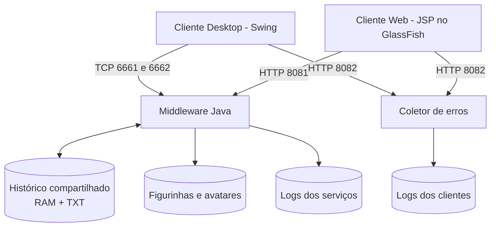

<p align="center">
  
</p>

<p align="center">
  
  
  
  
</p>

<p align="center">
  <b>Chat com clientes Desktop e Web, middleware Java, histórico compartilhado e serviços independentes.</b>
</p>

---

# Chat Distribuído — Documentação do Software

Projeto acadêmico da disciplina **Sistemas Distribuídos**, do curso de Engenharia de Computação. O sistema oferece um chat com clientes Desktop e Web, um middleware Java para comunicação e persistência, uma biblioteca centralizada de imagens e um serviço de coleta de erros.

## Sumário

- [1. Visão geral](#1-visão-geral)
- [2. Requisitos da atividade](#2-requisitos-da-atividade)
- [3. Arquitetura](#3-arquitetura)
- [4. Módulos do sistema](#4-módulos-do-sistema)
- [5. Interfaces de comunicação](#5-interfaces-de-comunicação)
- [6. Persistência e arquivos](#6-persistência-e-arquivos)
- [7. Registro de erros](#7-registro-de-erros)
- [8. Decisões técnicas](#8-decisões-técnicas)
- [9. Requisitos de ambiente](#9-requisitos-de-ambiente)
- [10. Compilação](#10-compilação)
- [11. Execução sem NetBeans](#11-execução-sem-netbeans)
- [12. Configuração de rede](#12-configuração-de-rede)
- [13. Testes e demonstração](#13-testes-e-demonstração)
- [14. Limitações e segurança](#14-limitações-e-segurança)

## 1. Visão geral

O Chat Distribuído permite que usuários conversem por dois clientes diferentes:

- **Desktop:** aplicação Java Swing que se comunica com o middleware por sockets TCP.
- **Web:** aplicação JSP publicada no GlassFish. O navegador utiliza HTTP para enviar e consultar mensagens.

O middleware centraliza o histórico da conversa, os arquivos de log e os recursos visuais. Dessa forma, mensagens enviadas por um cliente podem ser consultadas pelo outro, e ambos utilizam as mesmas figurinhas e avatares.

O projeto é composto por três aplicações independentes:

| Aplicação | Tecnologia | Artefato |
|---|---|---|
| Middleware | Java 21, sockets, `HttpServer` e Swing | JAR executável |
| Cliente Desktop | Java 21 e Swing | JAR executável |
| Cliente Web | JSP, HTML, CSS e JavaScript; compilação Java 17 | WAR para GlassFish |

## 2. Requisitos da atividade

O desenvolvimento atende ao escopo descrito na atividade prática de Sistemas Distribuídos, que solicita a evolução do chat existente sem remover suas funcionalidades, com prioridade para concorrência, rastreabilidade, serviços independentes, centralização de arquivos e execução fora do NetBeans.

| Item do enunciado | Solicitação | Implementação prevista no projeto |
|---|---|---|
| 1 | Carregar o histórico do TXT em memória e consultar a memória, sem reler o arquivo em cada acesso. | `Util` mantém uma lista compartilhada, carrega o arquivo na inicialização e sincroniza leituras e gravações. |
| 1 | Persistir a mensagem antes de tratá-la como salva. | A gravação no TXT ocorre antes da atualização da lista em memória e da confirmação ao cliente. |
| 2 | Manter o socket Desktop e criar atendimento Web independente. | Desktop utiliza TCP nas portas 6661 e 6662; Web utiliza HTTP na porta 8081. |
| 2 | Permitir ativar e desativar serviços separadamente. | O painel controla Desktop, Web e coletor de logs por ações distintas. |
| 2 | Escolher Platform Threads ou Virtual Threads e justificar. | Os atendimentos de rede utilizam Virtual Threads; a justificativa está na seção [Decisões técnicas](#8-decisões-técnicas). |
| 3 | Executar o servidor Web e publicar a aplicação sem depender do NetBeans. | O middleware fornece a API e as imagens por HTTP; a interface JSP é empacotada em WAR e publicada no GlassFish. |
| 3 | Centralizar figurinhas e disponibilizá-las por URL. | Imagens e avatares ficam na pasta `figurinhas` do middleware. |
| 4 | Receber erros de clientes em um coletor único, mas gravar um arquivo por tipo de cliente. | `POST /api/logs` recebe erros e os separa em arquivos `client_<tipo>_errors.log`. |
| 5 | Registrar erros do middleware em arquivos separados por serviço. | O middleware grava arquivos `server_middleware_<serviço>_errors.log`. |
| 6 | Gerar JARs do Middleware e Desktop e WAR do Web. | Os três módulos possuem configurações Maven de empacotamento. |
| 7 | Demonstrar concorrência, persistência, independência, imagens, logs e execução fora da IDE. | O roteiro de demonstração está na seção [Testes e demonstração](#13-testes-e-demonstração). |

## 3. Arquitetura

O middleware é o ponto central do sistema. Os clientes não compartilham diretamente arquivos locais: eles utilizam os serviços de comunicação do middleware.



O GlassFish hospeda as páginas JSP. O `HttpServer` do JDK, executado no processo do middleware, disponibiliza a API do chat, os catálogos de recursos e as imagens. São processos e responsabilidades diferentes.

### 3.1. Portas

| Porta | Protocolo | Responsabilidade |
|---:|---|---|
| 6661 | TCP | Consulta do histórico pelo cliente Desktop. |
| 6662 | TCP | Recebimento de mensagens do cliente Desktop. |
| 8081 | HTTP | API do chat, catálogos e arquivos de imagem. |
| 8082 | HTTP | Coletor centralizado de erros dos clientes. |
| 8080 | HTTP | Acesso padrão ao GlassFish; pode variar conforme o domínio. |

## 4. Módulos do sistema

### 4.1. Middleware — `SD-v4/Chat_Middleware_Service`

É o servidor central do sistema. Sua classe `Util` concentra as configurações, o histórico compartilhado, a inicialização dos serviços HTTP e o registro de erros.

Principais arquivos:

| Arquivo | Responsabilidade |
|---|---|
| `Run.java` | Inicializa o repositório e abre o painel ou inicia os serviços em modo sem interface. |
| `Chat_Middleware_Service.java` | Ponto de entrada da aplicação. |
| `Util.java` | Gerencia histórico, portas, serviços HTTP, recursos e logs. |
| `DesktopEnvioThread.java` | Mantém o socket de consulta do histórico na porta 6661. |
| `DesktopRecepcaoThread.java` | Mantém o socket de recebimento de mensagens na porta 6662. |
| `FrmPainelDeControle.java` | Permite iniciar e interromper os serviços individualmente. |

No painel, os controles relevantes são `BtnAtivarDesktop`, `BtnAtivarWeb` e `BtnAtivarLog`. O botão legado de terceiros não representa o coletor de logs.

### 4.2. Cliente Desktop — `SD-v4/Chat_Cliente_Desktop`

Aplicação Swing utilizada para entrar no chat, escolher identificação visual, enviar mensagens e consultar o histórico.

Principais arquivos:

| Arquivo | Responsabilidade |
|---|---|
| `FrmLogin.java` | Coleta nickname, cor e avatar. |
| `FrmChat.java` | Exibe a conversa, envia mensagens e disponibiliza emojis e figurinhas. |
| `Util.java` | Mantém os dados do usuário, endereço do middleware, portas e URLs. |

O cliente utiliza TCP para o fluxo de mensagens e HTTP para buscar imagens e enviar erros ao coletor.

### 4.3. Cliente Web — `SD-v6/Chat_Cliente_Web`

Aplicação JSP publicada no GlassFish e acessada pelo navegador.

| Arquivo | Responsabilidade |
|---|---|
| `index.jsp` | Tela de entrada e seleção de identificação visual. |
| `chat.jsp` | Valida os dados de entrada, cria a sessão e organiza a tela. |
| `topo.jsp` | Apresenta o usuário conectado. |
| `mensagem.jsp` | Consulta e apresenta o histórico periodicamente. |
| `conversa.jsp` | Envia mensagens e consulta os catálogos de recursos. |
| `WEB-INF/web.xml` | Define os endereços do middleware e do coletor. |

O navegador envia e consulta mensagens por HTTP. A atualização do histórico é feita por consultas periódicas, não por WebSocket.

## 5. Interfaces de comunicação

### 5.1. Comunicação Desktop por TCP

O cliente Desktop mantém compatibilidade com o protocolo de texto UTF utilizado pelo projeto original, por meio de `ObjectInputStream` e `ObjectOutputStream` com `readUTF()` e `writeUTF()`.

- **Porta 6661:** o cliente solicita o histórico; o servidor consulta a lista em memória e devolve o conteúdo.
- **Porta 6662:** o cliente envia uma mensagem; o servidor tenta persistir e responde `OK` ou `ERROR`.

A confirmação `OK` indica que a rotina de persistência foi concluída. O cliente deve limpar o campo de mensagem somente após receber essa confirmação.

### 5.2. API HTTP do middleware

Base local padrão: `http://127.0.0.1:8081`.

| Método | Endpoint | Descrição | Resposta |
|---|---|---|---|
| GET | `/health` | Verifica se o serviço HTTP está disponível. | Texto `OK`. |
| GET | `/api/messages` | Consulta o histórico compartilhado. | Conteúdo HTML do histórico. |
| POST | `/api/messages` | Envia uma mensagem para persistência. | `OK` ou erro HTTP. |
| GET | `/api/stickers` | Lista as figurinhas disponíveis. | Nomes separados por quebra de linha. |
| GET | `/api/avatars` | Lista os avatares disponíveis. | Nomes separados por quebra de linha. |
| GET | `/api/emojis` | Lista os caracteres Unicode oferecidos pelo sistema. | Um item por linha. |
| GET | `/figurinhas/{arquivo}` | Recupera uma figurinha. | Arquivo de imagem. |
| GET | `/figurinhas/avatars/{arquivo}` | Recupera um avatar. | Arquivo de imagem. |

O corpo de `POST /api/messages` contém o conteúdo da mensagem em texto UTF-8. O middleware só responde com `OK` depois de executar a persistência.

### 5.3. Coletor de erros

Endpoint: `POST http://127.0.0.1:8082/api/logs`.

O corpo recebido pelo coletor utiliza quatro campos separados por tabulação:

```text
 tipo<TAB>computador/identificação<TAB>Classe:Método<TAB>mensagem
```

O middleware acrescenta a data/hora e identifica o IP remoto da conexão antes de gravar o evento no arquivo do tipo de cliente correspondente.

## 6. Persistência e arquivos

### 6.1. Histórico

O histórico é armazenado em `data/RepositorioDesktop.txt` e mantido em uma lista compartilhada na memória do middleware.

Na inicialização, o arquivo é lido uma vez. Consultas posteriores usam a estrutura em memória. Ao receber uma mensagem, o middleware:

1. valida e normaliza o conteúdo;
2. adquire o bloqueio de escrita do histórico;
3. grava no final do TXT e solicita a persistência dos dados;
4. atualiza a lista em memória;
5. permite que o serviço confirme o recebimento ao cliente.

Se a gravação lançar uma `IOException`, a lista em memória não é atualizada e a mensagem não deve ser confirmada como persistida. O código também tenta restaurar o tamanho anterior do arquivo quando ocorre falha durante a escrita.

### 6.2. Diretórios

Estrutura utilizada pelo middleware:

```text
Chat_Middleware_Service/
├── data/
│   ├── RepositorioDesktop.txt
│   └── logs/
└── figurinhas/
    ├── beijo.png
    ├── coracao.png
    ├── dinheiro.png
    ├── fig1.gif
    ├── fig2.gif
    ├── risada.png
    ├── sorriso.png
    └── avatars/
        ├── batman.png
        ├── flash.png
        ├── indefinido.png
        ├── lanterna-verde.png
        ├── menina.png
        └── menino.png
```

Os arquivos reais podem variar conforme os recursos adicionados ao diretório. O catálogo é obtido pelo middleware; os nomes e as extensões devem corresponder exatamente aos arquivos, especialmente em sistemas Linux, que diferenciam maiúsculas de minúsculas.

### 6.3. Localização dos dados

Na versão de `Util.java` com o método `localizarDiretorioBase()`, o diretório-base é descoberto a partir da localização das classes ou do JAR. Ele pode ser sobrescrito por:

- propriedade Java `-Dchat.server.baseDir=C:\\caminho\\do\\servidor`;
- variável de ambiente `CHAT_SERVER_BASE_DIR`.

Exemplo no PowerShell:

```powershell
$env:CHAT_SERVER_BASE_DIR = "D:\ChatServidor"
java -jar .\target\Chat_Middleware_Service-1.0-SNAPSHOT.jar --headless
```

O diretório configurado passa a conter `data/` e `figurinhas/`. Confira no console os caminhos impressos durante a inicialização. Se a versão local de `Util.java` ainda declarar apenas `Path.of("data")` e `Path.of("figurinhas")`, os caminhos serão relativos ao diretório de trabalho (`user.dir`); nesse caso, aplique a versão corrigida com `localizarDiretorioBase()`.

O histórico e os logs são dados de execução, não código-fonte. Eles ficam na máquina que executa o middleware e devem ser incluídos em rotinas de backup quando precisarem ser preservados. Clonar o Git em outra máquina não copia automaticamente os dados gerados localmente.

## 7. Registro de erros

O sistema possui um único coletor HTTP para erros de clientes, mas mantém arquivos separados por tipo de cliente. Os erros internos do middleware são registrados localmente por serviço.

### 7.1. Erros dos clientes

Diretório: `data/logs/`.

| Arquivo | Origem |
|---|---|
| `client_desktop_errors.log` | Cliente Desktop. |
| `client_web_errors.log` | Cliente Web/navegador. |
| `client_<tipo>_errors.log` | Outros tipos de clientes. |

Formato de cada ocorrência:

```text
 data/hora | computador/identificação | IP | Classe:Método | mensagem do erro

```

No navegador, a identificação disponível ao JavaScript é baseada nas informações do agente do navegador; o navegador não fornece de forma geral o hostname real do computador ao JavaScript.

### 7.2. Erros do middleware

| Arquivo | Origem |
|---|---|
| `server_middleware_desktop_errors.log` | Serviço Desktop. |
| `server_middleware_web_errors.log` | Serviço HTTP/Web. |
| `server_middleware_internal_errors.log` | Falhas internas ou sem serviço cliente específico. |
| `server_middleware_<tipo>_errors.log` | Serviços futuros, se adicionados. |

Formato de cada ocorrência:

```text
 data/hora | serviço | cliente/identificação | IP | Classe:Método | mensagem do erro

```

Os registros são anexados ao arquivo existente, com uma linha em branco entre ocorrências. A implementação utiliza sincronização por arquivo para evitar que threads concorrentes misturem os registros.

## 8. Decisões técnicas

### 8.1. Virtual Threads

As Virtual Threads do Java 21 foram escolhidas para os atendimentos de rede do middleware: conexões TCP de consulta e recebimento, requisições HTTP e recebimento de logs. Essas tarefas passam boa parte do tempo aguardando entrada e saída de rede, portanto são predominantemente bloqueantes.

O uso de Virtual Threads permite estruturar o atendimento como uma tarefa por conexão sem manter uma Platform Thread dedicada para cada conexão. Os serviços mantêm seus próprios sockets HTTP/TCP e executores, o que também facilita o encerramento independente.

A interface Swing permanece sob responsabilidade da Event Dispatch Thread (EDT). Operações de rede do cliente Desktop devem ocorrer fora da EDT para não bloquear a interação com a interface.

### 8.2. Histórico em memória e TXT

A lista em memória evita abrir e ler o TXT a cada consulta. O TXT mantém a persistência entre reinicializações. O `ReentrantReadWriteLock` permite consultas concorrentes e serializa operações que alteram o histórico.

A decisão de gravar antes de atualizar a lista é necessária para impedir que uma mensagem seja apresentada como persistida quando a escrita falhou. A confirmação ao cliente é enviada somente depois da persistência.

### 8.3. Separação dos serviços

O Desktop, o atendimento Web e o coletor de logs podem ser iniciados ou interrompidos individualmente. A separação reduz o acoplamento operacional: uma falha ou manutenção em um serviço não exige, por projeto, o encerramento dos demais.

### 8.4. Centralização de imagens

As imagens são armazenadas no middleware e disponibilizadas por HTTP. Os clientes guardam referências/URLs, não caminhos absolutos locais. Isso permite que a mesma mensagem seja renderizada em máquinas diferentes e que novos recursos sejam disponibilizados sem recompilar os clientes.

### 8.5. Protocolo Web

O cliente Web usa HTTP porque é compatível com o navegador e com a aplicação JSP publicada no GlassFish. O histórico é atualizado por consultas periódicas ao endpoint HTTP; a implementação não depende de WebSocket.

## 9. Requisitos de ambiente

| Componente | Requisito |
|---|---|
| Middleware | JDK 21 ou superior, necessário para Virtual Threads. |
| Cliente Desktop | JDK 21 ou superior. |
| Cliente Web | Maven e servidor GlassFish compatível com Jakarta EE 11; o módulo está configurado para compilar com alvo Java 17. |
| Compilação | Maven 3.x ou Maven incluído na instalação do NetBeans. |
| Rede | Acesso às portas utilizadas pelos serviços e ao HTTP do GlassFish. |

A configuração compartilhada do NetBeans identifica o servidor de desenvolvimento como GlassFish 8 com suporte Jakarta EE 11. A implantação deve ser validada na instalação efetivamente utilizada.

## 10. Compilação

Os comandos abaixo são para PowerShell. Execute-os a partir da raiz do repositório.

Se `mvn` estiver no `PATH`, use o comando diretamente. Caso contrário, configure o Maven incluído no NetBeans, ajustando o caminho para a instalação local:

```powershell
$mvn = "$env:USERPROFILE\Downloads\netbeans-31-bin\netbeans\java\maven\bin\mvn.cmd"
Test-Path $mvn
```

O resultado de `Test-Path` deve ser `True`. Compile cada módulo:

```powershell
# Middleware
Set-Location ".\SD-v4\Chat_Middleware_Service"
& $mvn clean package

# Cliente Desktop
Set-Location "..\Chat_Cliente_Desktop"
& $mvn clean package

# Cliente Web
Set-Location "..\..\SD-v6\Chat_Cliente_Web"
& $mvn clean package
```

Artefatos esperados:

```text
SD-v4/Chat_Middleware_Service/target/Chat_Middleware_Service-1.0-SNAPSHOT.jar
SD-v4/Chat_Cliente_Desktop/target/Chat_Cliente_Desktop-1.0-SNAPSHOT.jar
SD-v6/Chat_Cliente_Web/target/Chat_Cliente_Web.war
```

O `clean package` remove a pasta `target` anterior e gera um novo artefato. Se a compilação falhar, corrija o erro antes de iniciar ou publicar a versão anterior.

## 11. Execução sem NetBeans

### 11.1. Middleware

Abra um terminal na pasta `SD-v4/Chat_Middleware_Service`.

Com painel de controle:

```powershell
java -jar .\target\Chat_Middleware_Service-1.0-SNAPSHOT.jar
```

Sem interface gráfica, iniciando os serviços automaticamente:

```powershell
java -jar .\target\Chat_Middleware_Service-1.0-SNAPSHOT.jar --headless
```

O modo `--headless` inicia Desktop, HTTP/Web e coletor de logs. Para encerrar, utilize `Ctrl+C`; o shutdown hook solicita o encerramento dos serviços.

### 11.2. Cliente Desktop

Abra outro terminal na pasta `SD-v4/Chat_Cliente_Desktop`:

```powershell
java -jar .\target\Chat_Cliente_Desktop-1.0-SNAPSHOT.jar
```

Quando o middleware estiver em outra máquina, informe o endereço do servidor:

```powershell
java -Dchat.server.host=192.168.1.50 -jar .\target\Chat_Cliente_Desktop-1.0-SNAPSHOT.jar
```

Substitua o endereço de exemplo pelo IP ou hostname real do middleware.

### 11.3. Publicação do WAR no GlassFish

Defina `GLASSFISH_HOME` como a pasta de instalação que contém a subpasta `bin`, e não como a própria pasta `bin`:

```powershell
$env:GLASSFISH_HOME = "C:\Users\<usuario>\GlassFish_Server"
$asadmin = Join-Path $env:GLASSFISH_HOME "bin\asadmin.bat"
Test-Path $asadmin
```

O último comando deve retornar `True`. Consulte e inicie o domínio:

```powershell
& $asadmin list-domains
& $asadmin start-domain domain1
```

Depois de gerar o WAR, publique-o sem NetBeans:

```powershell
& $asadmin deploy --force=true --precompilejsp=true `
  "C:\caminho\do\repositorio\SD-v6\Chat_Cliente_Web\target\Chat_Cliente_Web.war"
```

A opção `--precompilejsp=true` solicita a compilação dos JSPs durante o deploy. Isso permite identificar erros de tradução JSP antes de abrir a aplicação. Consulte o [manual de referência do GlassFish](https://glassfish.org/docs/latest/reference-manual.html) para as opções de `asadmin deploy`.

Confira a publicação:

```powershell
& $asadmin list-applications --type web
```

Endereço padrão:

```text
http://localhost:8080/Chat_Cliente_Web/
```

Para atualizar, execute novamente o deploy com `--force=true`. Para remover a aplicação:

```powershell
& $asadmin undeploy Chat_Cliente_Web
```

Para encerrar o domínio:

```powershell
& $asadmin stop-domain domain1
```

O GlassFish hospeda o WAR, mas não substitui o Middleware. O processo do Middleware deve estar ativo antes de testar o chat Web.

## 12. Configuração de rede

O arquivo `SD-v6/Chat_Cliente_Web/src/main/webapp/WEB-INF/web.xml` contém quatro parâmetros:

| Parâmetro | Utilizado por | Exemplo |
|---|---|---|
| `middleware.baseUrl` | Chamadas feitas pelo servidor Web ao middleware. | `http://127.0.0.1:8081` |
| `middleware.publicBaseUrl` | Navegador para API e imagens. | `http://192.168.1.50:8081` |
| `log.collector.url` | Servidor Web para o coletor. | `http://127.0.0.1:8082/api/logs` |
| `log.collector.publicUrl` | Navegador para enviar erros. | `http://192.168.1.50:8082/api/logs` |

Quando GlassFish e middleware estiverem na mesma máquina, os endereços utilizados pelo servidor podem apontar para `127.0.0.1`. Quando o navegador estiver em outro computador, os parâmetros públicos devem usar um endereço alcançável por ele.

Libere no firewall, conforme a topologia utilizada, as portas TCP 6661, 6662, 8081, 8082 e a porta HTTP do GlassFish (8080 por padrão). Não exponha a porta administrativa do GlassFish aos clientes.

## 13. Testes e demonstração

A demonstração deve reproduzir os itens solicitados pelo professor. Recomenda-se executar os testes com mais de um cliente conectado simultaneamente.

| Teste | Procedimento | Evidência esperada |
|---|---|---|
| Histórico inicial | Iniciar o middleware com um TXT já preenchido. | Mensagens antigas aparecem após carregar o repositório. |
| Persistência | Enviar mensagens pelo Desktop e pelo Web. | Mensagens aparecem nos dois clientes e são acrescentadas ao TXT. |
| Consulta em memória | Consultar o histórico repetidamente. | O atendimento usa a lista compartilhada, sem reler o arquivo a cada consulta. |
| Falha de gravação | Simular indisponibilidade/permissão negada no arquivo de histórico. | A mensagem não é incluída na lista nem confirmada com sucesso; o erro é registrado. |
| Concorrência | Conectar vários clientes e enviar mensagens simultaneamente. | Mensagens persistidas sem mistura ou perda causada por concorrência. |
| Independência | Desligar Web, Desktop ou coletor individualmente. | Os serviços restantes continuam em execução. |
| Recursos compartilhados | Selecionar e enviar avatares e figurinhas nos dois clientes. | As imagens são recuperadas por URL do middleware. |
| Erros do cliente | Provocar exceções em Desktop e Web. | Ocorrências aparecem nos arquivos de cliente correspondentes. |
| Erros do servidor | Provocar falhas em cada serviço do middleware. | Ocorrências aparecem nos arquivos por serviço. |
| Execução independente | Fechar o NetBeans e iniciar JARs e GlassFish pelo terminal. | O chat continua disponível pela URL publicada. |

Para comprovar a separação de logs, apresentar os arquivos abaixo:

```text
data/logs/
├── client_desktop_errors.log
├── client_web_errors.log
├── server_middleware_desktop_errors.log
├── server_middleware_web_errors.log
└── server_middleware_internal_errors.log
```

O tipo de cliente é normalizado antes de compor o nome do arquivo, permitindo registros como `client_mobile_errors.log`. Para adicionar um novo tipo de serviço do servidor, também é necessário ampliar a normalização de serviços em `Util`, que atualmente reconhece `desktop`, `web` e `internal`.

## 14. Limitações e segurança

Esta implementação tem finalidade acadêmica e deve ser utilizada em uma rede controlada. Antes de qualquer exposição pública, considere as seguintes limitações:

- Os endpoints HTTP utilizam HTTP sem TLS; credenciais e conteúdo não são criptografados em trânsito.
- O middleware libera CORS de forma ampla para permitir chamadas do navegador em outra porta.
- Os endpoints atuais não implementam autenticação ou autorização de usuários.
- O histórico armazena conteúdo HTML apresentado pelos clientes; a renderização desse conteúdo deve ser protegida contra injeção de HTML/JavaScript antes de uso fora de um ambiente controlado.
- O protocolo TCP Desktop utiliza `readUTF()`/`writeUTF()`, que possui limite de tamanho por mensagem.
- O endereço `127.0.0.1` só atende clientes no mesmo computador. Para acesso remoto, configure IP/hostname e firewall.
- Deve existir uma única instância do middleware escrevendo em cada diretório de dados, pois a sincronização implementada é local ao processo.

## Referência da atividade

**Atividade Prática — Sistemas Distribuídos: Evolução do chat e do middleware.** Documento fornecido na disciplina de Sistemas Distribuídos, Engenharia de Computação, com sete itens: persistência em RAM/TXT; serviços independentes; servidor Web e imagens compartilhadas; coleta de erros de clientes; logs por serviço; empacotamento e deploy; demonstração com múltiplos clientes.

---

**Projeto acadêmico — Engenharia de Computação — Sistemas Distribuídos.**
